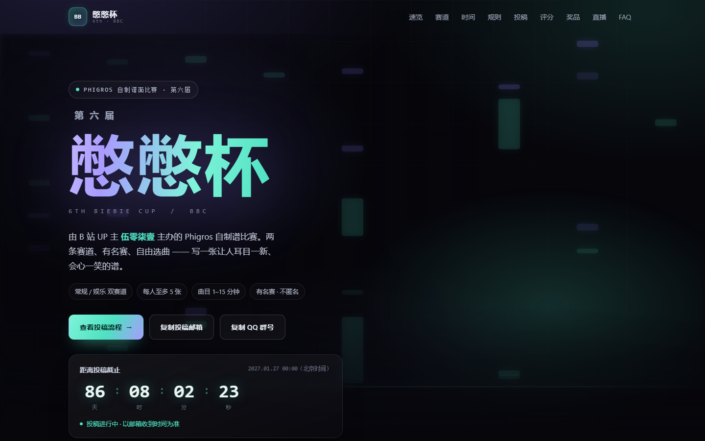

# 第六届憋憋杯 · 参赛信息站

基于《第六届憋憋杯参赛指南》整理的静态信息站，纯 HTML / CSS / JavaScript，无框架、无构建步骤，可直接部署到 GitHub Pages。



## 页面内容

| 板块 | 内容 |
| --- | --- |
| 顶部公告 | 可关闭的公告条（直播账号变更），关闭状态记在本地 |
| 首屏 | 赛事主视觉、动态音符背景、实时倒计时（自动切换「投稿中 / 已截稿 / 已结束」）+ 访客本地时区换算 |
| 01 速览 | 主办方、项目、投稿窗口、直播、邮箱、QQ 群六张信息卡 + 关键数字 |
| 02 赛道 | 常规 / 娱乐双赛道对比、个人 / 多人、5 张投稿上限 |
| 03 时间 | 五段时间线，按当前时间自动标记「已完成 / 当前阶段」；截稿、直播可一键加入日历（.ics） |
| 04 规则 | 匿名、可玩性、故事板、选曲红线、版权（手风琴） |
| 05 投稿 | 四步流程、邮件标题 / 正文 / 附件命名模板、懒人版邮件生成器、投稿自查清单、**投稿文件体检器**（本地解析 .pez / .zip） |
| 06 评分 | 普通票 / 真爱票 / 评委票、最终成绩构成、刷票警告 |
| 07 奖品 | 双赛道三甲、总排行奖励、奖品说明 |
| 08 直播 | 直播时间与账号、赛后公开渠道 |
| 09 违规 | 违规行为与处理措施 |
| 10 FAQ | 九个常见问题 + 群号 / 邮箱快捷操作 |

## 目录结构

```
.
├── index.html              # 单页站点
├── preview.png             # 站点预览图（README 用）
├── assets/
│   ├── css/style.css       # 设计系统与全部样式
│   ├── js/main.js          # 倒计时、时间线、复制、生成器、清单、体检器、日历、背景动画
│   ├── og.png              # 社交分享图（1200×630）
│   └── favicon.svg
├── .nojekyll               # 让 GitHub Pages 跳过 Jekyll 处理
└── README.md
```

## 本地预览

直接双击 `index.html` 即可（`file://` 下除剪贴板 API 会走降级方案外，其余功能均可用）。

若想更接近线上环境：

```bash
# 任选其一
python -m http.server 8080
npx serve .
```

然后访问 `http://localhost:8080`。

## 部署到 GitHub Pages

1. 新建一个仓库（例如 `biebiecup-6th`），把本目录全部文件推上去：

   ```bash
   git init
   git add .
   git commit -m "feat: 第六届憋憋杯参赛信息站"
   git branch -M main
   git remote add origin https://github.com/<你的用户名>/<仓库名>.git
   git push -u origin main
   ```

2. 打开仓库 **Settings → Pages**。
3. **Source** 选择 `Deploy from a branch`，**Branch** 选 `main`、目录选 `/ (root)`，保存。
4. 等待 1–2 分钟，访问 `https://<你的用户名>.github.io/<仓库名>/`。

> 所有资源都使用相对路径（`./assets/...`），因此部署在仓库子路径下也能正常加载。
> 如果绑定自定义域名，在 Pages 设置里填好域名即可，无需改代码。

## 日常维护

- **改文案**：直接编辑 `index.html` 中对应板块。
- **改时间**：`assets/js/main.js` 顶部的三个常量：

  ```js
  var T_OPEN     = new Date('2026-08-24T00:00:00+08:00');
  var T_DEADLINE = new Date('2027-01-27T00:00:00+08:00');
  var T_LIVE     = new Date('2027-02-08T19:00:00+08:00');
  ```

  倒计时、首屏状态文案、时间线高亮、.ics 日历、本地时区换算都由这三个时间驱动，改完即同步。
- **改主题色**：`assets/css/style.css` 顶部 `:root` 中的 `--mint` / `--violet` / `--gold`。
- **改生成器默认值**：`index.html` 中 `#generator` 里各 `input` 的 `placeholder`。
- **改公告条**：`index.html` 顶部 `.announce` 区块；关闭记录存在 `localStorage['bbc6.announce.account']`，改文案后把 JS 里这个 key 换成新版本（如 `bbc6.announce.2`）就会重新弹出。
- **换分享图**：替换 `assets/og.png`（建议 1200×630），并同步 `index.html` 头部 `og:image` / `twitter:image` 的绝对地址；换域名时记得一起改。
- **体检器**：依赖浏览器原生 `DecompressionStream`（Chrome / Edge 80+、Safari 16.4+、Firefox 113+）；不支持时只做结构检查并提示无法读取时长。

## 说明

- 本站为赛事信息整理页，非官方唯一渠道；规则、时间、奖品等以主办方最新通知为准，最终解释权归主办方所有。
- 页面无任何第三方请求（无 CDN、无统计、无字体外链），可离线打开；邮件生成器、自查清单与文件体检器均在本地浏览器运行，不会上传数据。
